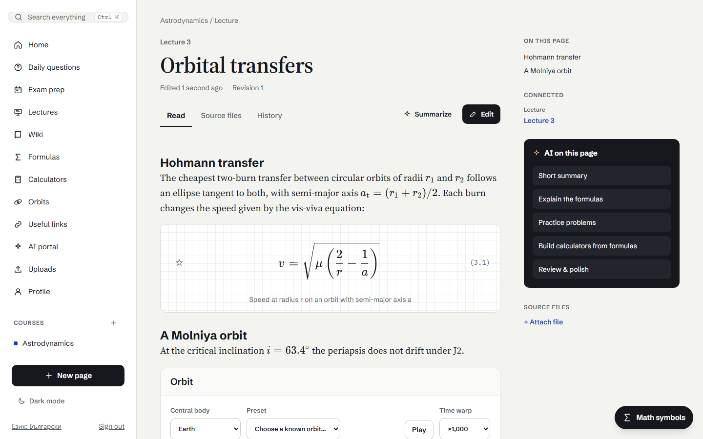

# Notecyclopedia

A personal study workbook and tutor for lecture notes. Keep your courses' lectures, notes and formulas as linked pages,
compute with your own calculators, explore orbits interactively, and ask Claude about your notes when you want help.
Courses can be shared with classmates.



It follows four rules:

- **Help on request.** Nothing calls Claude in the background or on a schedule, so API credits go only where you ask.
- **Tutor before solver.** Explanations and hints come first; the full solution is one click away, never hidden.
- **Compute, don't guess.** Numbers come from your calculators and the orbit code, not from the model.
- **Keep what you paid for.** Any answer can be saved into a page, so the same explanation is never generated twice.

## What you can do

- **Organise courses by lecture:** pages of every kind, each lecture's original slides, and links between lectures,
  pages, calculators and exam tasks. [Courses and lectures](docs/guide.md#courses-and-lectures)
- **Write notes with math:** formula blocks, inline `$…$` math, searchable headings, references between pages, and full
  revision history. [Pages, math and references](docs/guide.md#pages-math-and-references)
- **Build calculators** with units, theory and step-by-step solutions; check them automatically or with AI; embed them
  as calculators or plots; export them to Python, HTML or Excel. [Calculators](docs/guide.md#calculators)
- **Explore orbits** from Kepler elements in the plane and in 3D, with true speeds, J2 drift and ground tracks.
  [Orbit diagrams](docs/guide.md#orbit-diagrams)
- **Learn with an AI tutor** that answers from your notes, gives one hint at a time, checks photos of your working, and
  takes its numbers from your calculators. [AI tutor and reading help](docs/guide.md#ai-tutor-and-reading-help)
- **Revise for exams** with daily questions on request, revision plans, and quick checks of what you understood.
  [Daily questions and exam prep](docs/guide.md#daily-questions-and-exam-prep)
- **Bring in your files:** PDFs, Office documents and images are indexed for search, and a PDF can become a draft
  article. [Uploads and PDF articles](docs/guide.md#uploads-and-pdf-articles)
- **Keep a backup** of everything as one ZIP, and restore it as a copy. [Backup](docs/guide.md#backup)

The interface is in English and Bulgarian.

## Quick start

You need Node 22 or later, pnpm 10 or later, and Docker (for PostgreSQL).

1. Install the dependencies:

   ```bash
   pnpm install
   ```

2. Create your settings, then set `BETTER_AUTH_SECRET` (and `ANTHROPIC_API_KEY` for the AI features):

   ```bash
   cp .env.example .env
   ```

3. Start PostgreSQL and create the tables:

   ```bash
   pnpm db:up
   pnpm db:migrate
   ```

4. Run the app:

   ```bash
   pnpm dev
   ```

5. Open http://localhost:5173, create an account, create a course and add pages.

The API runs on port 3001. `docker compose stop db` stops the database. Every setting is described in
[configuration](docs/configuration.md).

## Common commands

| Command | What it does |
|---|---|
| `pnpm dev` | Web and server in watch mode |
| `pnpm test` | All tests (needs a test database, see [development](docs/development.md#tests)) |
| `pnpm lint` / `pnpm typecheck` | Lint and format check / type check |
| `pnpm build` | Production build; the server then serves the web app |
| `pnpm db:migrate` | Apply database migrations |

## Documentation

- [User guide](docs/guide.md): how every feature works.
- [Configuration](docs/configuration.md): every environment variable, with its default.
- [Development](docs/development.md): the code's layout, tests, coverage, performance and troubleshooting.
- [Roadmap](docs/roadmap.md): what comes next, and what each phase brought.
- [Design reference](design/README.md).

## License

[MIT](LICENSE).
