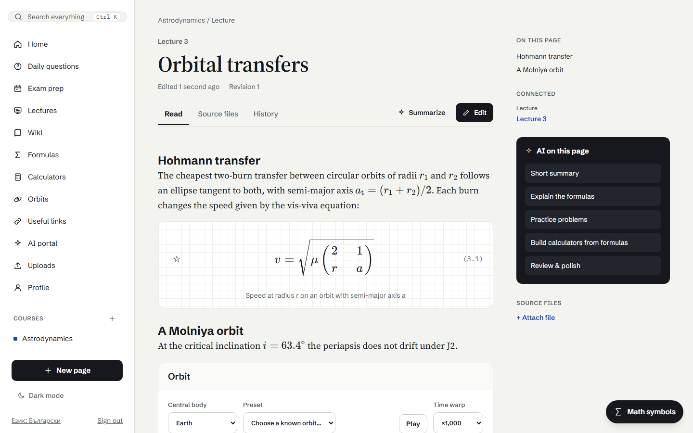
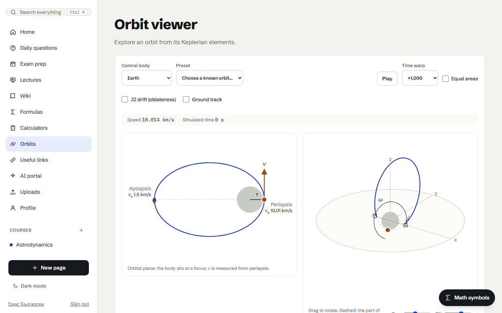

# User guide

How to use Notecyclopedia. For installing and running it, see the [README](../README.md); for settings, see
[configuration](configuration.md).

AI features call Claude only when you press their button, and show what each answer cost. Everything else works
without an API key.

- [Courses and lectures](#courses-and-lectures)
- [Pages, math and references](#pages-math-and-references)
- [Calculators](#calculators)
- [Orbit diagrams](#orbit-diagrams)
- [AI tutor and reading help](#ai-tutor-and-reading-help)
- [Daily questions and exam prep](#daily-questions-and-exam-prep)
- [Uploads and PDF articles](#uploads-and-pdf-articles)
- [Backup](#backup)
- [Settings](#settings)
- [Claude API usage (admins)](#claude-api-usage-admins)

## Courses and lectures

### Courses and members

A course holds pages, uploads and constants. Members are an **owner**, **editors** (who write) and **viewers** (who
read). To share a course, the other person signs up first; then the owner invites them by email from the course page.

A course page lists its pages in sections: **Lectures** (by lecture number), **Example problems**, **Theory**,
**Notes** and **Sources**. Empty sections are hidden and each can be collapsed. **Edit order** moves pages within
their section. An example problem's lecture number is the lecture it practises, so problems are listed under their
lecture, and each lecture shows how many it has.

The Wiki and course pages switch between **By type** (the sections above) and **By lecture**: each lecture with its
original, then its lecture page, theory, notes, sources, example problems and calculators; pages without a lecture come
last. The browser remembers the choice.

**In this course** on a course page links to its lectures, your calculators tagged with it, its formulas and your exam
plans for it.

### Original lectures

An upload (slides or a PDF) can be the **original** of a lecture:

1. In **Uploads**, give a lecture number while uploading (one file at a time), or use **Mark as original lecture** on
   a file already uploaded.
2. The number belongs to a course: the upload's course, or the course picked in the mark form (marking a file as
   another course's lecture moves it there).
3. Each lecture of a course has at most one original. Numbers already taken are listed and caught before saving.

An article created from an original starts with its lecture number. A file that moves to another course with its page
is unmarked.

### The Lectures tab

**Lectures** in the sidebar lists the originals in order. Each card opens the original and lists the lecture's pages,
example problems, calculators and exam-prep tasks. Lectures with pages or calculators but no original yet are named
underneath, with a link to Uploads.

**Edit → Move lecture** moves a whole lecture to another course or number: the original and, by default, its pages,
example problems and calculators, renumbered. Their attached files and search index follow. A number already taken
there is caught first.

### Lecture numbers everywhere

- Any page type (lecture, theory, notes, sources, example problems) can carry a lecture number. A page with one links to
  its lecture's original.
- A calculator tagged with a course can also be tagged with one of its lectures.
- An exam-prep task can point at a lecture of its plan's course.

### Getting around

Pages, lectures, exam-prep tasks, calculators and courses link to one another:

- **Connected** (beside a page, and under a calculator): the lecture and its original, the lecture's other pages, the
  calculators tagged with it or made from the page, and the tasks of your active exam plans that point at the page, the
  lecture or the calculator.
- **Lecture cards** list the tasks about the lecture. A link to a lecture (`/lectures#lecture-…`) scrolls to its card
  and highlights it.
- **A calculator** links to its course and lecture. The calculator library can open filtered to a course
  (`/calculators?course=…`).

### Useful links

**Useful links** in the sidebar lists NASA's Eyes, the Copernicus Browser, JPL Horizons and CelesTrak, each with a note
on what it is for. Add your own (name, address, note): they are saved to your profile, only `http(s)` addresses are
accepted, and removing one asks first.

## Pages, math and references

### Writing and history

Pages are edited in a rich-text editor with headings, lists, links, formula blocks, inline math, calculators, plots,
orbit diagrams and images. Every save is a new revision; a save based on an older revision is refused instead of
overwriting someone else's changes.

The **History** tab lists every revision. **Show changes** compares a revision with the one before, block by block
(formulas as LaTeX), with long unchanged stretches collapsed. Editors can **Restore this version**: it is saved as a new
revision, so nothing is lost.

**Review & polish** asks Claude to check a page for errors and clarity and propose a revised version. The proposal opens
next to the current page, where you can change it; **Restore AI version** discards your changes to it, and nothing is
saved until **Accept changes**. It is also the way to rewrite AI-sounding wording.

### Math

- **Formula blocks** hold displayed equations, with an optional label and description.
- **Inline math:** type `$…$` in a sentence (for example `$v_{esc}$`) and it is typeset; click it to edit the LaTeX. A
  space inside needs a LaTeX character, so "$5 and $" stays money.
- **AI text saved to pages** (daily questions, Save to page, topic hubs, PDF articles, Review & polish) is converted the
  same way: `$…$` and `\(…\)` become inline math, `$$…$$` a formula block, and Markdown formatting comes through.
- **A LaTeX tidy-up without AI** is applied to AI-written formulas: word subscripts become upright text
  (`a_{par}` → `a_{\text{par}}`; indices like `a_{ij}` and single letters like `a_p` are kept), `*` between factors
  becomes `\cdot`, and `\displaystyle` is dropped.
- **Tidy formulas** in the editor toolbar does the same for older pages: it converts math left as `$…$` text and tidies
  every formula. It is an ordinary edit to review, undo (Ctrl+Z) or save. Text in code is never changed.

### Terms and references

Every heading is a **term**: it keeps a stable id across edits and appears in search above whole pages, so searching a
topic opens the page at that section. Theory pages rank above the lectures they summarise.

**Reference** in the editor toolbar links the selected text (or inserts a name) to a page or to a term on it. References
open inside the app and scroll to the heading; a dotted underline tells them apart from web links. Each page lists
**Referenced by** (with the section each reference points to) and **On this page** (its own sections). Backups keep
references.

### Topic hubs

A **theory page** works best as a topic hub: a short overview, the key formulas, and links to where the course covers
the topic, rather than a copy of the lectures (copies drift apart and make search and the AI see everything twice).

On a theory page, **Draft topic hub with AI** uses the title as the topic. Claude writes the overview and formulas from
the course's notes and picks where the topic is covered from the course's matching sections; the app builds the links
from that list, so they always point at real sections. The draft only fills the editor.

### Formulas

The **Formulas** page groups formulas by course and lecture, with course filter chips and a text filter.

- **Formula cards** (no AI): click a formula to see where else it appears in your courses (compared without spaces) and
  the calculators made from or embedded in its page.
- **Pinned formulas:** the ☆ in front of a formula (while reading, on its card or in the Formulas list) pins it to your
  home page. Pins are your own and do not change the page, so everyone, viewers included, pins for themselves. Remove a
  pin from the home page with its × (it asks first).

## Calculators



### Your library

Calculators are **personal**: only you see, change and run yours. The **Course** field is a tag, not sharing: it sorts
the library and links the calculator to the course's lectures. Deleting or leaving a course clears the tag; the
calculators stay yours.

- **Sort and filter:** grouped by course (in course order, untagged last) and lecture, or sorted by name or last edited,
  with a **Show course** filter.
- **Archive:** hides a calculator from the library, the picker and the tutor; pages that embed it keep working.
  **Archived** lists them, and **Restore** brings one back.
- **Duplicate:** a copy with the same tags, linked to its original, to change while pages keep using the original.
- **Import .json:** add a calculator from a file exported here or written elsewhere.

### Editing

The visual editor sets the name, description and **theory**, the **inputs** (key, label, unit, default, min, max,
step), the **constants** and the **results** (key, label, unit, formula and a step explanation). **Edit JSON** shows
the same calculator as JSON. Constants are picked from the built-in scientific constants and the course's constants;
adding one copies its value and unit into the calculator (units are descriptive, not converted).

A calculator's page shows the theory and a **step-by-step solution**: each result's formula, the same formula with the
current values and units filled in, and the result.

Formulas are checked when saved against what both the Python and the HTML exports support: arithmetic, comparisons,
`and`/`or`/`not`, `condition ? a : b` and the common math functions. Write `theta deg` to use an input in degrees, for
example `sin(theta deg)`.

### Checks

**Automatic checks** (no AI) run whenever a calculator is shown or edited:

- every formula evaluates with the default values;
- every input and constant is used;
- each formula's units give its result's unit (compared as SI dimensions, so `sqrt(mu / r)` with μ in km³/s² and r in
  km gives km/s). Inputs without a unit count as plain numbers, angles as numbers, and units the app does not know
  (`AU`, `%`) are not checked rather than guessed.

**Physical constants are constants, not inputs.** A gravitational parameter given as an input (key `mu`, `μ`, `GM` or
`mu_…`, or labelled "gravitational parameter") is flagged, and **Make it a constant** turns it into one with the same key,
so pages that embed the calculator are unaffected. **Make constant** in the editor does the same for any input.

**Check formulas with AI** asks Claude to review the physics, units, defaults, theory and step explanations, with the
automatic checks attached. It lists its findings and the exact changes it proposes; **Edit with these changes** opens
them in the editor, and nothing is saved until you press Save.

**Rework with AI** takes a request in your words ("solve for the radius instead", "add the escape speed") and proposes
the reworked calculator the same way. Duplicate first to keep the original.

### In pages

The editor's **Calculator** button inserts a calculator as an interactive **calculator** or as a **plot**: choose the
input to sweep, its range and up to four results. Results with different units get a chart each. Readers change the
other inputs, read values with the pointer or arrow keys, and open a table of the values.

A block stores a copy of the calculator, so it works for every reader, survives backups and is visible to search and
the AI. **Update from library** pulls in later changes to your own original.

### Exports

| Format | What you get |
|---|---|
| `.json` | The calculator definition, to import elsewhere. |
| `.py` | A Python function; the theory in the docstring and each explanation above its step. |
| `.html` | A standalone page that works offline: the calculator, the theory and a live step-by-step solution. |
| `.xlsx` | An Excel workbook: input cells, each result as an Excel formula with its formula text and explanation, and the theory on a second sheet. |

### The calculator format

```json
{ "version": 1, "name": "Projectile motion",
  "theory": "Horizontal speed is constant; vertically the projectile accelerates downward at g.",
  "inputs":  [{ "key": "v0", "label": "Initial speed", "unit": "m/s", "default": 20 },
              { "key": "theta", "label": "Angle", "unit": "deg", "default": 30 }],
  "constants": { "g": 9.81 },
  "constantMetadata": { "g": { "name": "Standard gravity", "symbol": "g", "unit": "m/s²" } },
  "outputs": [{ "key": "T", "label": "Flight time", "unit": "s", "expr": "2 * v0 * sin(theta deg) / g",
                "explanation": "Twice the time to reach the top." },
              { "key": "R", "label": "Range", "unit": "m", "expr": "v0 * cos(theta deg) * T" }] }
```

`theory` (paragraphs separated by blank lines) and each `explanation` are optional. Each result can use the inputs, the
constants and the results above it.

## Orbit diagrams



Add an interactive two-body orbit to a page with **Orbit diagram** in the editor's Calculator dialog, or open **Orbits**
in the navigation for the standalone viewer. Its address takes the elements, for example
`/orbit?a=26600&e=0.74&i=63.4&argp=270`.

- **Elements:** set a, e, i, Ω, ω and ν with sliders or numbers, pick a preset (ISS, Sun-synchronous, GTO, GEO, Molniya,
  Tundra) or change the central body (Earth, Moon, Mars). Only closed orbits are supported (e below 0.99).
- **Orbital plane:** the body at a focus, the apsides, the position and velocity vectors, the true anomaly and the
  flight-path angle. The velocity arrow's length is the speed, with vₚ and vₐ to the same scale at the apsides.
  **Equal areas** shades sectors swept in equal times (Kepler's second law).
- **3D view:** the orbit against the reference plane (the part behind it dashed), the line of nodes and the Ω, i and ω
  angles. Drag it, or use Turn and Tilt, to rotate.
- **Play** runs a simulated clock. **Time warp** sets simulated seconds per real second (real time to ×100 000; at the
  default ×1 000 a low orbit takes about 5 s and a geostationary one 86 s), so orbits keep their true relative periods.
  The clock restarts when you change the orbit.
- **Derived values:** altitudes, period, the speeds at the apsides, the circular and escape speeds at the current
  radius, and the J2 drift rates. Pages show the key values with **More values**; the viewer shows all.
- **J2 drift** adds the secular effect of the equatorial bulge: the node regresses (which keeps the Sun-synchronous
  preset following the Sun at about 0.986° a day) and the periapsis precesses, except at the critical inclination 63.4°
  (Molniya, Tundra). The 3D view also draws the orbit 30 days later (dotted). Short-period terms, drag and third bodies
  are not modelled.
- **Ground track:** three orbits at a time on a 30° longitude–latitude grid, with Earth's coastlines (Natural Earth,
  public domain). For Earth, **Start (UTC)** sets Earth's rotation at the start, so longitudes are real; for the Moon and
  Mars, longitudes are relative.

Readers explore freely; in the editor, **Save orbit** stores the current elements as the block's starting orbit.

**GMAT and FreeFlyer files.** GMAT scripts (`.script`) and FreeFlyer mission plans (`.MissionPlan`) can be uploaded.
**Preview** shows them as read-only text (nothing is run) and lists each spacecraft whose initial orbit the file
defines, with **Open in orbit viewer**. The files are read by an independent parser of their plain-text assignments; no
GMAT or FreeFlyer code is included or needed. FreeFlyer is a trademark of a.i. solutions, Inc. GMAT is developed by
NASA. Notecyclopedia is not affiliated with or endorsed by either.

## AI tutor and reading help

### The AI portal

The portal answers from your notes and cites them as `[n]`. Its six modes:

| Mode | What it does |
|---|---|
| **Ask** | Answers a question about your notes. |
| **Tutor** | Helps you solve a problem yourself: explains the idea, asks what you tried, gives one hint at a time. **Next hint** and **Show full solution** are one click away. |
| **Check my working** | Takes the problem and your attempt, typed or as up to three photos, and points out the first mistake instead of redoing it. |
| **Summarize** | A short summary of the material. |
| **Solve** | A worked solution, step by step. |
| **Build calculator** | Explains the formulas and makes reusable calculators from them. |

- **Sources:** choose which courses to search, or all of them.
- **Photos:** **Add photo**, or paste an image into the message box. Photos are downscaled in the browser and kept with
  the conversation, so follow-up questions still see them.
- **Numbers come from your calculators.** Claude can search your calculators and run one instead of doing the
  arithmetic itself. Each run is shown under the answer with its step-by-step solution, and you can change its inputs.
  Only your own calculators, not archived ones, are visible to it.
- **Orbit diagrams:** Claude can show one with its answer ("show me a Molniya orbit"), to explore or open in the viewer.
- **Calculators on request:** under a Solve answer, or a full solution from the tutor, **Make a calculator from this**
  makes them from the solution (one calculator per independent calculation, up to six) and keeps them with the answer.
- **Cost:** every answer shows its tokens, the estimated cost and the model.
- **Sessions:** your recent sessions are listed beside the chat; open one to continue it.

### Help while reading

While reading a page, select text and choose **Explain**, **Why does this hold?** or **Show an example**, or click a
formula block for the same questions. The answer opens in a side panel with the page as its source, and can be
continued in the AI portal.

**Keep the answer** so it is paid for once: **Add to page** opens the page editor with the answer added at the end as an
unsaved change, under a heading naming the question. In the AI portal, **Save to page** does the same for any page an
answer cites.

**Check my understanding** under an answer (portal and reading panel) asks two or three short questions about it. It is
made once, when you press it, and kept with the answer; answers stay hidden until you show them.

## Daily questions and exam prep

### Daily questions

**Daily questions** (sidebar, and **Today's question** on the home page) are study questions about your recent
lectures, made only when you ask; answers stay hidden until you want them.

- **Today's question:** **Generate** makes the first question of your day; pressing it again costs nothing. Pick a
  course or all of them (remembered in the browser).
- **Ask me a question** makes another one at any time.
- **Topics** are the headings of your six most recent lectures and theory pages, chosen without AI: a topic never asked
  comes first, then the one asked longest ago. When a topic comes up again, Claude is shown your earlier questions and
  asked for a different aspect.
- **Grounded:** the question and model answer come from that section's notes, in the notes' language; anything beyond
  the notes is labelled.
- **Check my answer** opens the tutor's Check my working mode. **Tell it as a story** and **Harder question** are kept,
  so each costs at most one call. **Ask your own question** opens the tutor. **Save to page** appends the question, its
  answer and expansions to its page.
- **All questions:** newest first, grouped by day, with a course filter, search and **Load more**.

### Where was I

The home page shows the pages you opened most recently, your latest AI sessions, and **Topics you asked about** (the
pages your answers of the last 30 days came from). It comes from your own activity, with no AI.

### Exam prep

**Exam prep** in the sidebar proposes a revision plan:

1. Choose a course, the exam date (up to 90 days ahead), minutes a day and the weekdays you study.
2. Optionally choose the exam's scope (which pages it covers) and how well you know each page (*I know it*, *Shaky*,
   *New to me*).
3. Claude proposes the plan in one call, with more time for shaky and new pages; the app fills in the dates and page
   links, so they always point at real days and pages.

Keeping the plan current needs no AI:

- Tick tasks off, rename, remove or add tasks, move a task to another study day, or change the exam date. Each change is
  saved at once.
- **Catch up** spreads unfinished tasks from past days over the study days left; after moving the exam earlier, **Move
  before the exam** does the same for tasks after it.
- **Link** on a task points it at a lecture of the course and at your calculators.
- **Pause / Resume** keeps a plan but leaves it out of today's revision. Plans whose exam has passed are folded under
  **Past exams**. A course can have several plans (a midterm and a final); proposing another while one is ahead warns
  first.
- **Today's revision** on the home page shows today's tasks to tick off, and a link to catch up when earlier ones are
  left.

**Export** downloads a plan as a JSON file; **Import a plan** reads one into any of your courses, linking tasks to that
course's pages by id or title. **Share a copy** sends a plan to a member of its course, who can accept it (it becomes
their own plan, with nothing ticked off) or decline it. Shared and imported plans keep each task's lecture but not its
calculators, which are personal.

## Uploads and PDF articles

**Uploads** lists your files 50 at a time (**Show more** loads the next ones), with a search by file name and a course
filter. PDFs, Office documents (DOCX, PPTX, XLSX, ODF), text and images can be uploaded to a course; their text is
extracted and indexed for search and the AI.

- Images (also those added with the editor's **Image** button) are transcribed by Claude for search when an API key is
  set: one paid call per image.
- Files are served with the type of their extension. Only PDFs, images and plain text open in the browser; everything
  else downloads.

**Create wiki article** turns a text-based PDF into a page:

1. After the PDF is indexed, choose **Create wiki article** in Uploads.
2. Claude drafts an article from the PDF's text (up to 80,000 characters). Review and edit the title, tags, text and
   formulas.
3. **Accept** creates a lecture page in the same course, with the PDF as its source file.

Scanned PDFs without embedded text need OCR first.

## Backup

**Profile → Data backup** downloads a ZIP of the courses you can access: pages and their history, calculators, course
constants and uploaded files. It leaves out passwords, sessions, AI conversations and browser preferences.

**Import a backup** checks and previews an archive (**Preview backup**), then creates new private copies owned by
you. It never merges with or
overwrites existing data; references, lecture originals and calculator tags point at the copies, and search indexes
are rebuilt.

The page shows when your last backup finished and reminds you when there is none or it is older than 14 days. Nothing
is backed up automatically.

## Settings

- **Language:** English or Bulgarian, switched at the bottom of the navigation and remembered in the browser. The AI
  answers in the language you write in, or that of your notes.
- **Theme:** light or dark, from the navigation or the sign-in screen, remembered in the browser.
- **Time zone:** your day for daily questions and exam prep. Every account uses `Europe/Sofia` (EET) until a setting is
  added.

## Claude API usage (admins)

Accounts listed in `ADMIN_EMAILS` see **Claude API usage** in the navigation: recent Claude requests with their full
prompts, status, model, tokens and estimated cost, 50 at a time. Prompts can contain private questions and course
material, so allow only trusted people. Image data is not stored. Estimates are not billing records. See
[configuration](configuration.md#ai) for the daily token limit, log retention and prices.
